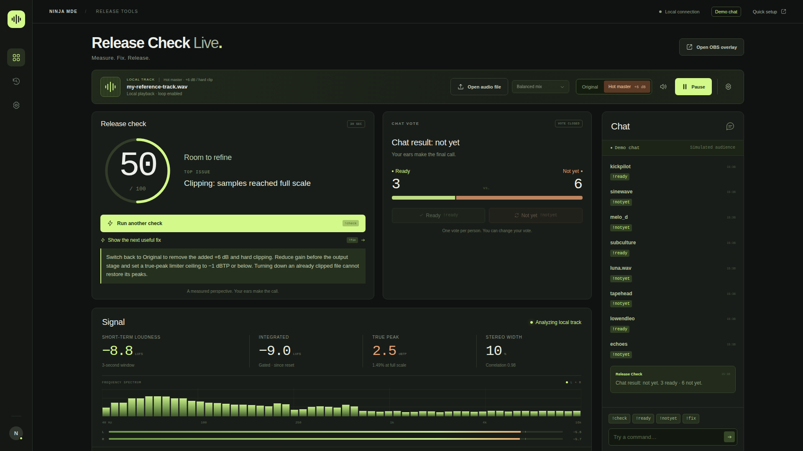
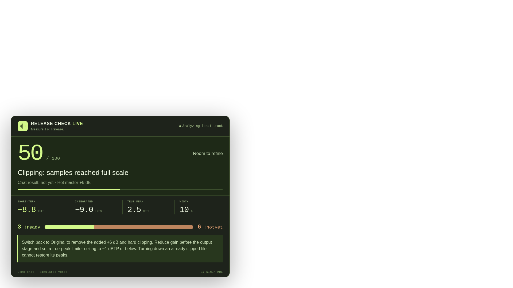

# Release Check Live

**Measure. Fix. Release.**

By Ninja MDE (Vadim Timchenko).

A local control room and transparent OBS overlay for music producers. Measure the audio, run a 30-second check, then let the audience vote on the next step. The default demo works without a Twitch account, credentials, recordings, or paid services.

## Browser verification

At 1920 × 1080 and 100% zoom, the same locally loaded reference WAV measured **100/100 in Original** and **50/100 in Hot master**. The second check reported clipping and displayed its fix. These images show demo chat; a real Twitch-channel recording is pending account setup.

[Original: 100/100](docs/screenshots/original-1920.png)





## Start in demo mode

Requires Node.js **20.19+** and npm. From this folder, run:

```bash
npm run setup
```

This installs dependencies and starts the local development server. On subsequent runs, use `npm run dev`.

1. Open **http://127.0.0.1:5173** in Chrome or another modern Chromium browser.
2. Click **Play**. Allow about three seconds for the short-term meter to settle.
3. Click **Run release check**, or send `!check` in the demo chat.
4. After 30 seconds, the measured score appears and voting opens for 20 seconds. The named demo audience casts simulated votes; your local vote counts once and can be changed.
5. Send `!fix` to show a practical suggestion. Switch **Original → Hot master +6 dB** to check the same audio with added gain and hard clipping, or choose **Phase issue** for a different generated example.

The loop is synthesized in the browser from deterministic oscillators and percussion noise. It contains no third-party music. File and demo playback begin with sound on. **Play/Pause** retains the loaded track and its playback position. The separate speaker control mutes playback without stopping measurement; its crossed-out icon means the output gain is zero. Input monitoring stays muted to prevent feedback.

Demo mode makes **no Twitch requests**. Audio, spectrum data, chat, and scores travel between your browser and the Node process on the same computer. Tracks are never uploaded. Browser checks assert that the demo makes no external HTTP requests.

## OBS setup

1. Keep the server and **one control-room tab** open. This tab owns audio capture and measurement.
2. In OBS, add a **Browser Source** with URL **http://127.0.0.1:5173/overlay**.
3. Set width **1920**, height **1080**. The page background is transparent; a compact meter and vote card sits at the bottom left. Disable “Shutdown source when not visible” if you want it to stay connected across scenes.
4. Use your existing OBS audio routing for the broadcast. The overlay displays values and does not play audio.

The overlay receives the control room’s shared session over a local WebSocket. It does not independently analyze audio or compete for the input. Additional control-room tabs are viewers until the current owner closes; reload a viewer to take control. If the owner tab closes or its input stops delivering measurements, an unfinished check is cancelled instead of scoring stale audio. Session state and history clear when the server restarts.

**Audio input matters:** an OBS Browser Source does not automatically receive the OBS mixer. Use **Change audio source → Capture an audio input**, select a stereo loopback or interface input, and allow browser microphone permission. Disable signal processing in the loopback/interface. The browser requests echo cancellation, noise suppression, and automatic gain control off, but device behavior may vary. A physical microphone is useful for testing capture, not for measuring an existing digital mix. Input monitoring stays off to avoid feedback.

Click **Open audio file** in the main audio bar to replace the generated demo with your own track. Choose a WAV, MP3, FLAC, M4A, or OGG file supported by your browser; the filename appears in the audio bar and playback starts. Files decode locally and repeat without being uploaded. You can also choose **Open a local track** from the audio source menu. Large files require browser memory; use a representative excerpt if decoding fails. Mono sources are duplicated to two channels for this stereo instrument, so a mono file’s indicated loudness follows that duplication.

**Original / Hot master +6 dB** switches the loaded file or demo loop in one click. Hot master multiplies each sample by `10^(6/20)` and hard clips it to `[−1, +1]` before measurement and monitoring. The decoded source and real file stay unchanged. Each switch clears the previous score and vote and starts fresh metering; switching is disabled during a 30-second check. A quiet source may remain below clipping after +6 dB: the app reports measured issues rather than forcing a low score. The preset is unavailable for live input capture.

For the recording sequence and track selection, see [docs/DEMO.md](docs/DEMO.md). At 1920 × 1080 and 100% browser zoom, the score and top issue sit directly beneath the track bar. **Analyzing local track** describes file playback, **Demo chat** identifies the simulated audience, and **Live on Twitch** appears when the Twitch bridge is connected.

## Connect your own Twitch channel

The installed-client design uses the **broadcaster’s own user access token** for their own channel. No cloud server or public webhook is needed. Twitch supports user-token EventSub WebSockets for this pattern. See [Twitch’s installed-chatbot authorization guide](https://dev.twitch.tv/docs/chat/authenticating/).

1. [Register a Twitch application](https://dev.twitch.tv/docs/authentication/register-app/). Use an appropriate application category and add `http://localhost:3000` as an OAuth redirect URL for the Twitch CLI token flow.
2. Install the [official Twitch CLI](https://dev.twitch.tv/docs/cli/) and run `twitch configure`. Enter that application’s client ID and secret when prompted. These are CLI settings; this app does not need the client secret.
3. Get a **user access token** while signed in as the broadcaster:

   ```bash
   twitch token --user-token --scopes "user:read:chat channel:read:redemptions"
   ```

   Follow the CLI authorization prompt. The redirect and scope syntax are documented in the [official token command](https://dev.twitch.tv/docs/cli/token-command/). An app access token cannot be used here.

4. Copy `.env.example` to `.env` and set:

   ```dotenv
   MODE=twitch
   TWITCH_CLIENT_ID=your_application_client_id
   TWITCH_USER_ACCESS_TOKEN=your_broadcaster_user_access_token
   TWITCH_REWARD_TITLE=Request a release check
   ```

5. Create a custom channel-points reward with the exact title **Request a release check** in your Twitch creator dashboard. You can set `TWITCH_REWARD_ID` to match a specific reward instead of its title. Custom channel-points availability depends on your Twitch channel’s eligibility. Chat works without channel points; the interface reports when that subscription is unavailable.
6. Restart the app, choose a stereo audio source, and look for **Chat + channel points connected** in Quick setup. From your channel’s chat, send `!check`, then `!ready`, `!notyet`, and `!fix`. Redeem the custom reward in a later round to start another check.

The bridge validates the token and client ID at startup and revalidates periodically. It subscribes to `channel.chat.message` and `channel.channel_points_custom_reward_redemption.add`, handles keepalives and reconnect migration, resubscribes after lost connections, and deduplicates event IDs. It reads messages and displays responses in the overlay; it does not send messages back to Twitch chat. See [EventSub WebSocket lifecycle](https://dev.twitch.tv/docs/eventsub/handling-websocket-events/) and [subscription types](https://dev.twitch.tv/docs/eventsub/eventsub-subscription-types/).

Credentials stay in the server process and the ignored `.env` file. They never appear in browser snapshots. There is no automatic token refresh; if authorization expires or is revoked, obtain a new user token and restart. The server binds to loopback and accepts local WebSocket origins; this is a personal local tool, not an internet-facing hosting configuration.

The app stays on **port 5173** after authorization. The Twitch CLI's port 3000 is a temporary OAuth callback and closes when authorization completes. If Twitch's rewards API returns **403: “The broadcaster must have partner or affiliate status,”** keep `TWITCH_REWARD_ID=` empty. The app reports **Chat connected · channel points unavailable** and chat commands continue to work. A 401 missing-scope response requires a new user token with `channel:read:redemptions`; use the token command above. See [Get Custom Reward](https://dev.twitch.tv/docs/api/reference/#get-custom-reward).

## Commands

| Command | Behavior |
| --- | --- |
| `!check` | Start a fresh 30-second measurement if audible input is ready and no round is running. |
| `!ready` | Vote ready during the 20-second audience window. |
| `!notyet` | Vote not yet, replacing the same user’s previous vote if needed. |
| `!fix` | Reveal the largest measured issue’s suggestion after a check. |

Twitch user IDs identify voters; repeated messages do not add votes. Every local control-room vote is one person (`you`). Ties and rounds with no votes have explicit verdicts. Audience votes do not change the audio score. Demo voters are labeled as simulated and are disabled in Twitch mode.

## What the meters and score mean

- Loudness: stereo ITU-R BS.1770 K-weighting, 400 ms overlapping energy blocks every 100 ms, an absolute −70 LUFS gate, and a relative −10 LU gate. Short-term loudness is an ungated 3-second window.
- True peak: a 4×, 32-tap-per-phase, Blackman-windowed sinc interpolation estimate, including original sample peaks. The displayed value holds the maximum since reset.
- Stereo: raw-channel energy correlation and side-to-total energy width. Mono-compatible identical channels show 0% width; opposing channels approach 100%. Width is an energy ratio, not a pan position.
- A check resets the measurement window. Scoring uses integrated loudness and held peak from that window, plus the final 3-second stereo correlation and crest factor.

The **house preference** is −14 ±2 LU integrated and a ceiling of −1 dBTP. Measured samples reaching full scale cost 35 points; otherwise excess true peak costs up to 35. Loudness outside the window costs up to 25; negative correlation up to 25; crest factor below 6 dB up to 15. The score is clamped to 0–100. These are disclosed listening preferences, not a delivery standard or a release certification. Exact formulas, limitations, and primary references are in [docs/MEASUREMENT.md](docs/MEASUREMENT.md).

The tool does not infer that bass, musical balance, composition, or audience taste is “wrong” from a meter. No score is issued for silence or an interrupted check. Check the full track and a matched-loudness reference before deciding.

## Development and verification

```bash
npm test             # DSP, reference, scoring, session, presets, status, demo and Twitch fixtures
npm run build        # TypeScript validation and production bundle
npm start            # Serve the production build on the same local port
npm run test:e2e     # Real browser audio, Original → Hot video flow, OBS, mobile and commands
```

Browser tests use an installed Chrome at `/usr/bin/google-chrome`. Set `CHROME_PATH` to your Chromium/Chrome executable on another system. FFmpeg is optional: when installed, the numeric suite compares multitone fixtures at 44.1 and 48 kHz with its `ebur128` meter; otherwise those two comparisons are marked skipped. No Twitch credentials are used by tests.

`npm run check` runs the full sequence. Browser tests start their own production server in demo mode on port **5183** (override with `E2E_PORT`); your development demo on 5173 can stay running. Run `npm run build` first if invoking the browser suite separately. The browser suite takes about three minutes because it observes real 30-second checks and 20-second votes without accelerating clocks.

```text
src/core/dsp.ts          Shared measurement math
src/core/scoring.ts      Transparent deductions
src/audio/              AudioWorklet, original synthesis, capture/playback
src/ui/                 Control room and overlay markup
src/main.ts             Browser interactions and local connection
server/session.ts       Authoritative check, votes, and history
server/twitch.ts        Optional Twitch EventSub client
server/index.ts         Local HTTP and WebSocket server
tests/                  Numeric, fixture, and browser checks
```

## Current scope

The local demo is implemented and tested. A real broadcaster token and Twitch chat EventSub subscription have been verified. The adapter also has fixture-based tests, including an ineligible channel whose chat commands keep working. **A complete real-chat round, OBS broadcast and video recording remain to be verified.** No competition entry or video has been submitted. Competition rules in the supplied handoff are context, not independently verified eligibility or deadline guidance.

Build provenance: this project was created in OpenAI Codex, in a new folder outside the Vrenvo repository. Session ID: `01a1934e-20d6-7c62-9dce-727bcd7e85a3`. No Vrenvo packages or services are used.

MIT license. The original generated demo and included SVG mark are part of this project.
